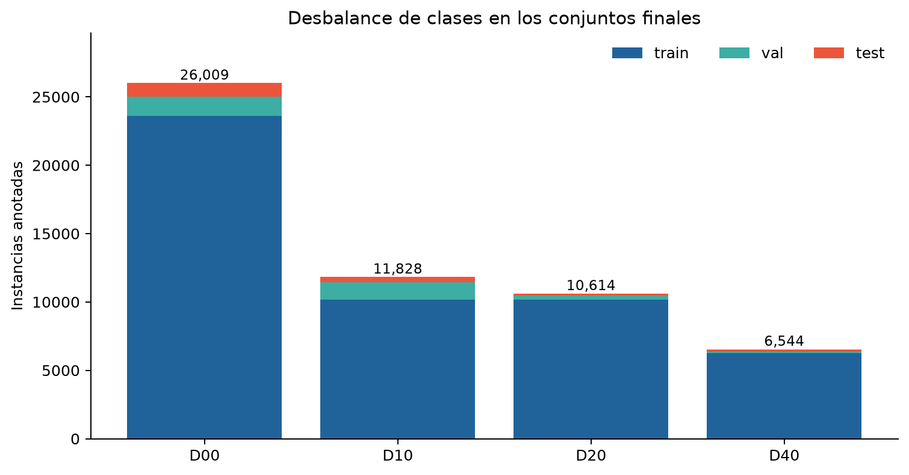
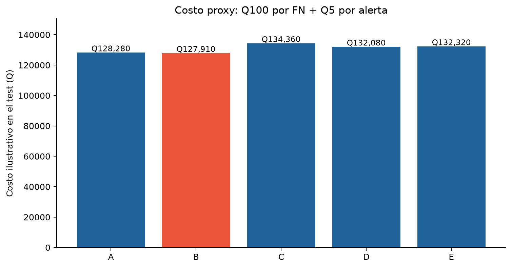
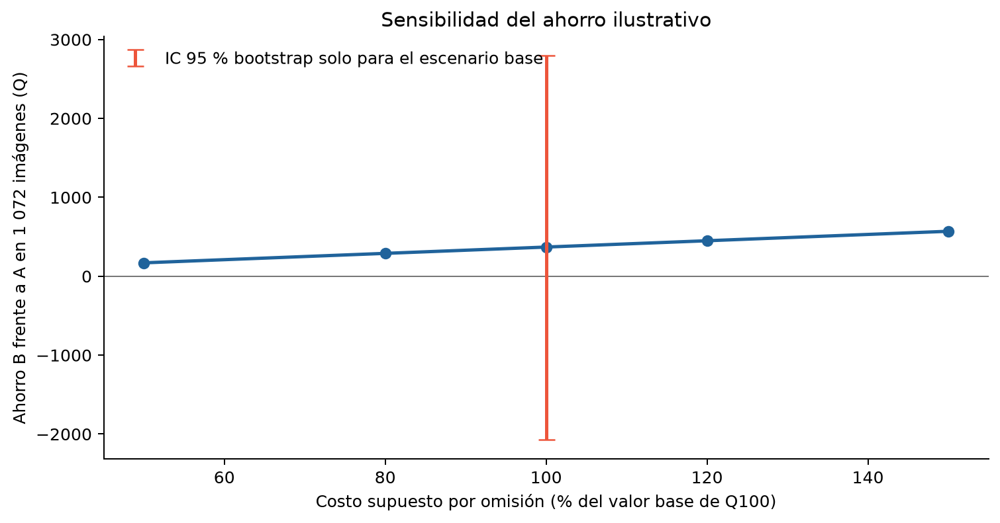
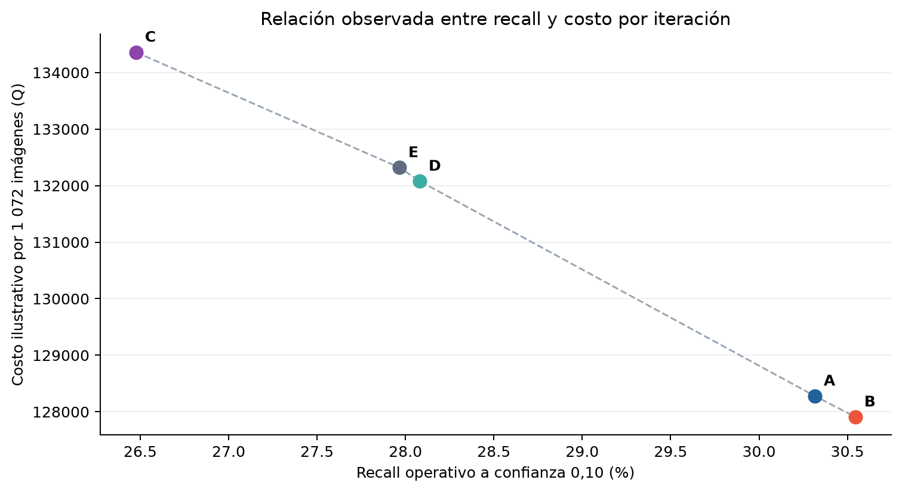
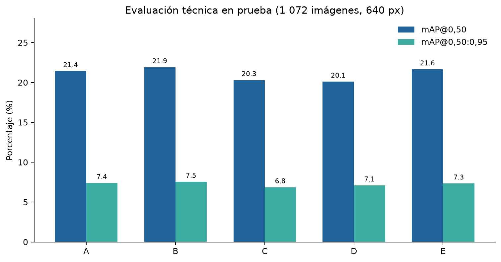
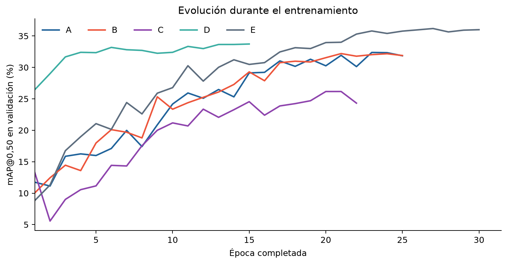
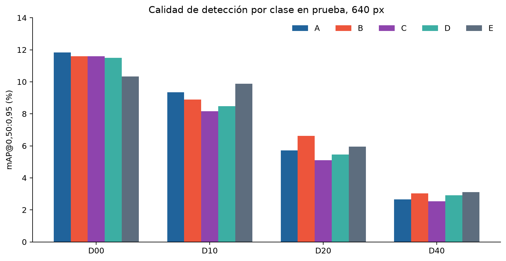

# RoadGuard AI: detección asistida de daños visibles en pavimento

**Curso:** CC3092 Deep Learning y Sistemas Inteligentes  
**Tipo de entrega:** trabajo escrito del proyecto final  
**Integrantes:** Sebastian Garcia y Ana Laura Tschen  
**Fecha:** 18 de noviembre de 2026  
**Repositorio:** [RoadGuard AI](https://github.com/tsc221645/roadguard)

> **Alcance de los resultados.** Las métricas de exactitud proceden del conjunto de prueba Czech. El equipo también probó la aplicación con imágenes de Guatemala, según su confirmación directa; los archivos revisados no conservan URL, coordenadas ni anotaciones manuales para medir exactitud. La procedencia de los videos no está establecida. El conjunto de datos de aproximadamente 15 GB se conserva fuera de Git por su tamaño; el repositorio contiene código, manifiestos, reportes y checkpoints. Los importes en quetzales son un escenario ilustrativo con costos supuestos, no gastos observados de una institución.

## Resumen

RoadGuard AI es un prototipo académico local que detecta grietas longitudinales (D00), transversales (D10), tipo piel de cocodrilo (D20) y baches o deterioros agrupados en D40 a partir de imágenes y videos. Se ajustaron cinco versiones de YOLO11 con datos RDD2022 y se evaluaron sobre 1 072 imágenes de prueba del dominio Czech. A 640 píxeles, el modelo B alcanzó mAP@0,50 de 21,91 % y mAP@0,50:0,95 de 7,54 %. Con confianza 0,10 e IoU 0,50 detectó 533 de 1 745 daños etiquetados (recall operativo 30,54 %) y generó 1 342 alertas, de las cuales 809 fueron falsas positivas. Frente a A evitó cuatro omisiones adicionales y produjo seis alertas más. Con costos **supuestos** de Q100 por omisión y Q5 por alerta, el costo proxy fue Q127 910 para B y Q128 280 para A: Q370 menos en el lote de prueba. El intervalo bootstrap pareado del ahorro (95 %, Q−2 075 a Q2 795) incluye cero. La mejora económica, por tanto, no está demostrada con precisión suficiente, y la tasa de omisión impide proponer el sistema como sustituto de una inspección humana. En la aplicación se completaron 16 análisis sobre 8 imágenes de Guatemala y 2 videos distintos; son pruebas de funcionamiento sin etiquetas manuales para calcular exactitud.

## 1. Contexto de negocio y problema

El usuario previsto es un equipo municipal, concesionario o contratista que inspecciona calles mediante recorridos grabados. En un flujo manual, una persona ve el material, identifica defectos, registra evidencia y decide qué segmentos necesitan revisión de campo. RoadGuard propone que la persona examine primero las detecciones sugeridas por el modelo. La salida es apoyo para priorizar una inspección, no un diagnóstico estructural, una estimación de profundidad ni una orden automática de reparación.

La unidad de decisión del prototipo es una **detección visual por imagen o fotograma**. Una misma grieta puede aparecer en varios fotogramas y generar varias alertas. Por ello, el conteo bruto expresa alertas por imagen, no daños físicos independientes. El análisis económico de este informe utiliza esa misma unidad de conteo.

El escenario de negocio se expresa por lote de 1 072 imágenes, la unidad disponible en el test. Sus indicadores son daños etiquetados omitidos, alertas para revisión, tiempo de inferencia y costo ilustrativo del lote. **El modelo A sirve como línea base experimental:** 1 216 omisiones, 1 336 alertas y Q128 280 de costo supuesto; B se compara con esos valores. Esta línea base describe un modelo anterior, no el costo observado de una inspección manual. Los resultados no se extrapolan a kilómetros ni a presupuestos mensuales.

Se eligió detección con deep learning porque los defectos tienen formas, escalas, iluminación y fondos variables, y el flujo requiere localizar múltiples objetos dentro de una imagen. Una regla basada en color o bordes es una alternativa conceptual más simple; la comparación experimental presentada aquí se concentra en cinco configuraciones de YOLO11.

## 2. Datos y análisis exploratorio

### 2.1 Origen y preparación

La fuente es [RDD2022](https://arxiv.org/abs/2209.08538), conjunto multinacional de imágenes viales. El reto oficial identifica las clases [D00, D10, D20 y D40](https://crddc2022.sekilab.global/data/). El inventario local contiene **47 420 imágenes** de seis países: Japón 13 133, Noruega 10 201, India 9 665, Estados Unidos 6 005, China 4 878 y Czech 3 538. De ellas, 35 490 quedaron marcadas `ready`, 2 894 contenían solo clases ignoradas, 9 035 no tenían XML y una era inválida. Estas categorías suman las 47 420 imágenes.

La conversión Pascal VOC → YOLO aceptó 23 766 muestras con anotaciones de las cuatro clases. Antes del split se excluyeron **dos imágenes duplicadas con anotaciones contradictorias**, documentadas en `data/manifests/split_exclusions.csv`. El conjunto final tiene **23 764** imágenes. No se incluyeron imágenes sin anotación como negativos de entrenamiento; esta decisión puede influir en la frecuencia de falsas alarmas.

| Conjunto | Imágenes | Grupos de origen | Instancias D00 | D10 | D20 | D40 |
|---|---:|---:|---:|---:|---:|---:|
| Entrenamiento | 20 773 | 5 | 23 595 | 10 166 | 10 160 | 6 261 |
| Validación (China Drone) | 1 919 | 1 | 1 426 | 1 263 | 293 | 86 |
| Prueba (Czech) | 1 072 | 1 | 988 | 399 | 161 | 197 |

La división es **por grupo de origen**, no aleatoria por fotografía: cada grupo permanece en una sola partición. `ml/build_splits.py` y el reporte de split registran semilla 42, hashes de manifiestos y verificación de archivos. El código permitía enlaces de similitud perceptual, pero el reporte indica `similarity_links_sha256: null`; por tanto, la ausencia de duplicados visuales entre particiones no está certificada. La prueba Czech mide transferencia a ese dominio. Las imágenes de Guatemala usadas para probar la aplicación no forman parte de este test.



*Figura 1. Conteos del reporte de split. Las clases no tienen la misma frecuencia y el dominio de prueba contiene 197 instancias D40.*

### 2.2 Distribución, calidad y representatividad

El EDA del inventario anterior al filtrado registra **55 003 instancias** de las cuatro clases: D00 26 015 (47,30 %), D10 11 830 (21,51 %), D20 10 614 (19,30 %) y D40 6 544 (11,90 %). Son conteos del inventario completo, distintos de los del dataset final. La mediana de resolución fue 640 × 640 píxeles, aunque el ancho llegó a 4 040 y la altura a 2 044. Las medianas de área relativa de caja variaron: 1,17 % para D00, 1,07 % para D10, 8,18 % para D20 y 0,54 % para D40. Las cajas D40 son especialmente pequeñas, una posible dificultad de detección que exige inspección visual de errores.

El reporte marca 9 035 imágenes sin XML y 2 894 con solo clases fuera de alcance; no deben describirse todas como datos perdidos, pues parte de las imágenes puede no tener daños de las cuatro clases. País y tipo de cámara se infieren de rutas de archivos, no de geolocalización. Las condiciones de luz, superficie y tránsito no están etiquetadas. Además, validación y prueba tienen solo un grupo de origen cada una; sus intervalos por imagen no capturan la variación entre ciudades, cámaras o recorridos. Los indicadores de exactitud de este documento corresponden al test Czech.

Las imágenes pueden mostrar placas, personas o fachadas. El procesamiento local mantiene las imágenes en el equipo de ejecución. El tratamiento de imágenes con terceros y la redistribución de datos o pesos están sujetos a controles de acceso, retención y las condiciones de la [fuente oficial](https://crddc2022.sekilab.global/data/) y de las dependencias. La licencia AGPL-3.0 del código no sustituye esas licencias.

## 3. Modelo de valor

### 3.1 Cuentas operativas y función

`ml/operational_metrics.py` empareja predicciones y anotaciones **de la misma clase** con IoU ≥ 0,50. La comparación siguiente usa las mismas 1 072 imágenes, tamaño 640 y confianza 0,10. VP son cajas correctas, FP alertas que no coinciden y FN daños etiquetados no encontrados. Una detección con clase equivocada puede contar como FP y FN; también puede haber daños visibles sin etiqueta que se contabilicen como FP. Estas cuentas difieren de la precisión/recall agregados por Ultralytics en `metrics.json`, cuyo procedimiento de resumen es distinto; no se mezclan en una misma fórmula.

| Modelo | VP | FP | FN | Alertas (VP+FP) | Precisión operativa | Recall operativo | F1 operativo |
|---|---:|---:|---:|---:|---:|---:|---:|
| A | 529 | 807 | 1 216 | 1 336 | 39,60 % | 30,32 % | 34,34 % |
| B | 533 | 809 | 1 212 | 1 342 | 39,72 % | 30,54 % | 34,53 % |
| C | 462 | 750 | 1 283 | 1 212 | 38,12 % | 26,48 % | 31,25 % |
| D | 490 | 826 | 1 255 | 1 316 | 37,23 % | 28,08 % | 32,02 % |
| E | 488 | 836 | 1 257 | 1 324 | 36,86 % | 27,97 % | 31,80 % |

La función implementada asigna un costo proxy por lote:

\[
C = c_{omisión}\,FN + c_{revisión}\,(VP+FP).
\]

Los coeficientes predeterminados de `ml/value_analysis.py` son **Q100 por FN** y **Q5 por alerta revisada**. Q5 equivale en el escenario a dos minutos de revisión a Q150/hora; tanto el tiempo como la tarifa son hipotéticos. Q100 tampoco procede de un estudio de tiempos, contrato o presupuesto de una entidad. El modelo no distingue gravedad o clase del daño. La función presentada considera omisiones y revisiones por caja; captura, cómputo, almacenamiento y despliegue quedan fuera de este escenario numérico.

### 3.2 Resultados económicos ilustrativos

Con esos coeficientes, las cuentas de prueba producen los siguientes costos **por 1 072 imágenes**, sin extrapolación mensual:

| Modelo | Q por omisiones | Q por alertas | Costo proxy total | Diferencia frente a A |
|---|---:|---:|---:|---:|
| A | 121 600 | 6 680 | **128 280** | Referencia |
| B | 121 200 | 6 710 | **127 910** | Q370 menos |
| C | 128 300 | 6 060 | 134 360 | Q6 080 más |
| D | 125 500 | 6 580 | 132 080 | Q3 800 más |
| E | 125 700 | 6 620 | 132 320 | Q4 040 más |

El paso de A a B evita **cuatro FN**, que en el supuesto valen Q400, y añade **seis alertas**, que cuestan Q30: diferencia neta **Q370** (0,29 % del costo de A). Bajo la equivalencia hipotética de dos minutos por alerta, B requiere **12 minutos adicionales** de revisión en este lote a cambio de cuatro cajas menos omitidas. El archivo `value_scenario.json` reporta un intervalo bootstrap pareado por imagen de **Q−2 075 a Q2 795** para el ahorro de B frente a A (5 000 remuestreos, semilla 42). Incluye cero; no permite sostener que B sea económicamente superior con seguridad. Tampoco cubre incertidumbre de costos, cambio de país ni dependencia de fotogramas del mismo recorrido.



*Figura 2. Costo calculado de VP, FP y FN a un umbral común. No representa costos observados.*

### 3.3 Sensibilidad y elección de umbral

Si el costo por FN cambia en ±20 % o ±50 % y Q5 por revisión se mantiene fijo, el ahorro bruto B frente a A es Q170, Q290, Q370, Q450 y Q570 para Q50, Q80, Q100, Q120 y Q150 por omisión, respectivamente. La ventaja puntual se mantiene pequeña y la incertidumbre estadística del caso base sigue incluyendo una posible pérdida. El punto de equilibrio entre A y B, con Q5 por alerta, es **Q7,50 por omisión**: cuatro omisiones evitadas compensarían exactamente seis revisiones adicionales. Ese punto solo describe el escenario algebraico y no valida sus precios.



*Figura 3. Ahorro puntual al variar el costo supuesto de omisión. La barra vertical corresponde al intervalo bootstrap solo en el escenario Q100.*

La relación entre calidad técnica y costo también se observa al comparar las cinco iteraciones al mismo umbral. De C a B, el recall operativo sube de 26,48 % a 30,54 % y el costo ilustrativo baja de Q134 360 a Q127 910 por lote. La figura siguiente es una **curva discreta entre modelos**, no una curva de umbral ni una estimación causal aislada del recall: también cambian las falsas alarmas y la arquitectura.



*Figura 4. Relación observada entre recall y costo en A–E, con confianza 0,10 y supuestos Q100/Q5.*

Los barridos existentes de A y B probaron umbrales 0,10–0,70 en validación y eligieron **0,10 por F1**, no por costo. La elección documentada responde a F1, mientras que la función de costo se aplica a las cuentas operativas del umbral seleccionado. La consulta del test durante las iteraciones A–E limita su independencia como evaluación confirmatoria.

## 4. Metodología de desarrollo

RoadGuard ajustó detectores [YOLO11](https://docs.ultralytics.com/models/yolo11/) preentrenados. La red localiza y clasifica varias cajas por imagen; esto se ajusta a defectos de forma y escala variables. El alcance experimental compara arquitecturas y configuraciones de YOLO11; no asigna un beneficio incremental frente a reglas visuales o inspección manual. El entrenamiento usa semilla 42 y modo determinista. Los archivos `args.yaml` registran función compuesta de pérdidas de caja, clasificación y distribución (`box`, `cls`, `dfl`) con ponderaciones 7,5, 0,5 y 1,5 de la configuración efectiva de Ultralytics. La pérdida favorece localización y clasificación de cajas; no pondera directamente el costo de FN, FP o cada clase. La función de valor evalúa ese intercambio después de entrenar, con el umbral elegido por F1.

| Iteración | Checkpoint inicial | Configuración distintiva | Épocas completadas |
|---|---|---|---:|
| A | YOLO11n preentrenado | 640 px, batch 4, lr0=0,001, rotación 0°, optimizador `auto` | 25 |
| B | YOLO11n preentrenado | 640 px, batch 4, lr0=0,0005, rotación 3°, optimizador `auto` | 25 |
| C | YOLO11n preentrenado | Como B, objetivo 50 épocas | **22** |
| D | Mejor checkpoint de B | 768 px, AdamW, lr0=0,0001, cosine LR, mosaic 0,2 | 15 |
| E | YOLO11s preentrenado | 640 px, batch 8, AdamW, lr0=0,001, cosine LR, cache RAM | 30 |

C tiene **22 registros de época**, aunque su configuración solicitó 50; se informa solo el entrenamiento documentado. Con `optimizer=auto`, la corrida C utilizó MuSGD y una tasa efectiva alta, según el registro comparativo del proyecto. En B y C, `lr0=0,0005` fue el valor **solicitado**, pero `optimizer=auto` puede elegir otra tasa; no se atribuye el cambio de rendimiento a esa tasa nominal como si hubiera sido aplicada. D se entrenó a 768 px, pero para comparar los cinco modelos en prueba se usaron sus métricas y cuentas **a 640 px**. Los reportes adicionales a 768 px se mantienen como experimento separado: D obtuvo mAP@0,50 de 21,72 % a 768 frente a 20,10 % a 640; el análisis económico compara exclusivamente inferencias a 640 px. La comparación final A–E usa la misma resolución de inferencia.

Los registros muestran aumento de datos y regularización de la configuración Ultralytics, incluido mosaic; los cambios específicos están en `args.yaml`. Las iteraciones A–E constituyen la exploración documentada de arquitectura e hiperparámetros. El costo computacional se informa como tiempo de ejecución, sin convertirlo a costo eléctrico. La comparación de modelos se limita a detectores profundos. El flujo de preparación, hashes, entrenamiento, evaluación y valor se implementa en los scripts `ml/` y `scripts/`.

## 5. Resultados de iteraciones

La tabla de prueba usa el mejor checkpoint de cada corrida y **640 px para todos**. Las métricas P y R de Ultralytics son resúmenes de su validación de detección y no equivalen a los conteos operativos a confianza fija de la sección 3. La columna de tiempo es el tiempo acumulado del último registro de entrenamiento, no tiempo de GPU facturado.

| Modelo | P test | R test | mAP@0,50 test | mAP@0,50:0,95 test | mAP@0,50 val, última época | Tiempo registrado | Mediana inferencia test |
|---|---:|---:|---:|---:|---:|---:|---:|
| A | 34,38 % | 25,94 % | 21,42 % | 7,39 % | 31,85 % | 123,9 min | 7,40 ms/imagen |
| B | 32,36 % | 29,45 % | **21,91 %** | **7,54 %** | 31,89 % | 125,0 min | 7,15 ms/imagen |
| C | 31,15 % | 24,61 % | 20,29 % | 6,85 % | 24,32 % | 131,5 min | 7,00 ms/imagen |
| D | 31,69 % | 26,92 % | 20,10 % | 7,08 % | 33,72 % | 92,2 min adicionales a B | 7,06 ms/imagen |
| E | 33,93 % | 29,30 % | 21,64 % | 7,32 % | **36,00 %** | 175,3 min | 9,13 ms/imagen |

Los registros de la última época también permiten comparar las pérdidas durante el entrenamiento y la validación:

| Modelo | Pérdida de caja train | Pérdida de caja val | Pérdida de clasificación train | Pérdida de clasificación val |
|---|---:|---:|---:|---:|
| A | 1,664 | 1,756 | 1,636 | 2,172 |
| B | 1,657 | 1,806 | 1,637 | 2,154 |
| C | 1,775 | 1,876 | 1,923 | 2,375 |
| D | 1,640 | 1,796 | 1,639 | 2,171 |
| E | 1,569 | 1,736 | 1,454 | 2,125 |

La pérdida de clasificación en validación supera a la de entrenamiento en todas las corridas. Junto con la brecha entre validación y test, esta diferencia motiva cautela sobre generalización; no permite identificar por sí sola sobreajuste, porque las particiones provienen de dominios distintos.

En test, B tiene el mAP@0,50 y mAP@0,50:0,95 más altos de las cinco corridas a 640 px, pero las diferencias frente a A son **0,49** y **0,15 puntos porcentuales**, respectivamente. E tiene mayor precisión de Ultralytics que B (33,93 % frente a 32,36 %) y un F1 descriptivo calculado de sus medias P/R de **31,45 %** frente a **30,84 %**; no equivale al F1 operativo de cajas a umbral fijo. E logra un mAP de validación superior al resto al final de su entrenamiento, sin trasladar esa ventaja a Czech. Esto es consistente con un cambio de dominio o ajuste a validación, pero no identifica por sí solo la causa. D exigió 92,2 minutos de ajuste **además** de los 125,0 minutos de B, sin superar a B en prueba a 640 px.



*Figura 5. Métricas de prueba de los mejores checkpoints; comparación homogénea a 640 px.*



*Figura 6. mAP@0,50 durante las épocas registradas. Las curvas son de validación; el test se evaluó aparte.*

En los CSV, el **máximo por época** de mAP@0,50 en validación fue 32,38 % (A), 32,20 % (B), 26,17 % (C), 33,72 % (D) y 36,18 % (E). Estos máximos no necesariamente ocurrieron en la misma época que el máximo de mAP@0,50:0,95 ni representan por sí solos la evaluación del checkpoint final.

| Modelo | D00 | D10 | D20 | D40 |
|---|---:|---:|---:|---:|
| A | 11,83 % | 9,35 % | 5,71 % | 2,66 % |
| B | 11,61 % | 8,89 % | **6,62 %** | 3,04 % |
| C | 11,60 % | 8,16 % | 5,10 % | 2,54 % |
| D | 11,50 % | 8,47 % | 5,45 % | 2,90 % |
| E | 10,34 % | **9,88 %** | 5,95 % | **3,11 %** |

*Tabla. mAP@0,50:0,95 por clase en el test a 640 px. Los valores bajos de D40 aparecen en las cinco versiones.*



*Figura 7. Desempeño por clase: una métrica global puede ocultar la dificultad para detectar baches.*

El error por clase limita la utilidad actual. En B, D40 tiene **23 VP, 47 FP y 174 FN** de 197 instancias (recall 11,68 %); D20 tiene **65 VP, 277 FP y 96 FN** (precisión 19,01 %). La métrica global oculta estas diferencias. El reducido tamaño mediano de las cajas D40 y el desbalance de clases ayudan a interpretar este resultado, aunque no prueban una causa única. Las diferencias pequeñas de mAP se interpretan descriptivamente porque las corridas comparten semilla y no se estimó incertidumbre para esa métrica.

## 6. Despliegue y experiencia de usuario

La implementación disponible es una aplicación **local** con FastAPI y una interfaz web. El flujo implementado es:

```text
Imagen o video
      ↓
Validación de extensión y tamaño (máximo 500 MB)
      ↓
Cola local de trabajos, procesados de uno en uno
      ↓
YOLO11n ajustado: cajas, clases y confianza
      ↓
Imagen/video anotado + resumen + detections.json
      ↓
Revisión humana y descarga del reporte
```

La persona puede cargar JPG, JPEG, PNG, WEBP, MP4, MOV, AVI o MKV, ajustar la confianza, seguir el progreso y descargar evidencia visual y JSON. La API ofrece estado del trabajo y un endpoint de salud. Cuando el checkpoint no está disponible, responde con error de servicio; si el formato o tamaño no es admitido, rechaza la carga. Los trabajos en memoria dejan de estar consultables al reiniciar el servidor; los archivos de resultados se guardan localmente. El procesamiento secuencial evita que varios trabajos compitan a la vez por la GPU, pero limita el throughput.

Los reportes operativos registran para B **16,14 s** de tiempo total sobre 1 072 imágenes, mediana de inferencia de **7,15 ms/imagen** y percentil 95 de **12,95 ms/imagen** en una RTX 3050 de 8 GB. El tiempo total equivale a unas **66,4 imágenes/s** en ese lote y equipo; no representa throughput de la aplicación completa, que incluye carga, cola, video, guardado y revisión humana. E utilizó aproximadamente **24 GB de RAM** para caché de imágenes durante entrenamiento. Las mediciones operativas cuantitativas presentadas corresponden al lote Czech en RTX 3050 y no incluyen tiempo de revisión humana ni consumo eléctrico.

### 6.1 Pruebas de funcionamiento con archivos cargados localmente

El recuento de archivos cargados y reportes generados en el equipo de pruebas registra **16 análisis completados: 13 de imágenes y 3 de videos**. Al descontar repeticiones, corresponden a **8 imágenes de Guatemala, según confirmación del equipo, y 2 videos distintos**. Todos los reportes completados usaron el modelo B. El umbral habitual fue 0,10; una imagen también se procesó con 0,05 y 0,80. El equipo disponía de una NVIDIA GeForce RTX 3050 de 8 GB. Las imágenes muestran en algunos casos marcas de Google Street View, pero los archivos no conservan URL ni coordenadas. La procedencia geográfica de los dos videos no se estableció; `progress_smoke.mp4` fue una prueba técnica.

| Archivo o conjunto | Resultado registrado | Interpretación |
|---|---|---|
| 8 imágenes distintas, umbral 0,10 | 13 detecciones: D00 4, D10 2, D20 2 y D40 5 | Propuestas del modelo, no aciertos confirmados |
| `roadguardvs2.mp4` | 1 198 detecciones en 1 216 fotogramas: D00 100, D10 1, D20 952 y D40 145 | Conteo por fotograma; no son 1 198 daños únicos |
| `progress_smoke.mp4` | 20 detecciones D00 en 20 fotogramas; se procesó dos veces | Prueba técnica repetida |

La revisión visual informal identificó una marca D00 sobre una grieta visible en `ca9.png` (confianza 0,31), otra marca D00 sobre una línea de pavimento junto a juntas o reparaciones en `image_2026-11-10_165546567.png` (confianza 0,18) y cero detecciones en `av bolivar.png` pese a líneas y reparaciones visibles. Estas observaciones **no clasifican formalmente aciertos, falsas alarmas u omisiones**: las imágenes no tienen anotaciones manuales que establezcan clase y límites de cada zona. En una imagen repetida, las detecciones cambiaron de **5 a 3 y 0** con umbrales **0,05; 0,10 y 0,80**, respectivamente. El experimento muestra la sensibilidad del conteo al umbral, sin determinar cuál salida es correcta. Los tiempos de esos archivos y de revisión humana no se registraron; las latencias de la sección anterior corresponden exclusivamente al test Czech.

**La aplicación actual no recibe GPX, no calcula coordenadas y no fusiona detecciones entre fotogramas.** En videos, el resumen cuenta detecciones por fotograma; por ello el valor calculado se refiere a alertas visuales, no a incidencias geolocalizadas únicas.

El monitoreo operativo se centra en tasa de alertas, distribución de confianza, tiempo por archivo, fallos de carga y porcentaje de detecciones rechazadas por el revisor. Los cambios de cámara, ruta, temporada o superficie pueden alterar estas distribuciones. La interfaz presenta la confianza y mantiene la decisión final en manos del inspector.

## 7. Explicabilidad, ética y riesgos

Las superposiciones de cajas, clase y confianza son la herramienta de **explicación visual aplicada** en la interfaz: muestran dónde se propuso cada daño y con qué puntuación. En `ca9.png` permiten ubicar la marca D00 sobre una grieta visible; en otra imagen exponen la ambigüedad entre grieta, junta y reparación. No explican qué rasgos internos causaron la predicción. El sistema no aplica Grad-CAM, SHAP ni análisis de atención, de modo que las superposiciones no deben interpretarse como atribuciones causales.

El principal riesgo técnico es la transferencia entre dominios. Las métricas del dominio Czech no cuantifican la precisión en calles de Guatemala, aunque la aplicación se probó con imágenes guatemaltecas. Las condiciones de pavimento, iluminación, cámara y zona pueden alterar las predicciones. Las falsas alarmas consumen tiempo de revisión y las omisiones pueden retrasar una inspección de campo.

El prototipo no debe usarse como certificación de seguridad vial, para descartar daños sin revisión humana ni para calcular costos de reparación. Las imágenes de recorridos pueden incluir datos personales incidentales y requieren controles de acceso y retención. La ausencia de GPS impide afirmar ubicación exacta del daño; incluso con GPS futuro, la posición de la cámara sería aproximada.

## 8. Discusión, viabilidad y conclusiones

Los resultados confirman un flujo local que produce evidencia visual, un test separado por dominio y una comparación económica reproducible con supuestos explícitos. A 640 px, B es el mejor de los cinco modelos en mAP y en costo proxy del escenario Q100/Q5. Sin embargo, su ventaja frente a A es de solo **Q370 por 1 072 imágenes**, y el intervalo bootstrap del ahorro abarca desde una pérdida de Q2 075 hasta una ganancia de Q2 795. La comparación no establece un beneficio económico estadísticamente concluyente, y una ventaja puntual tan pequeña es sensible a los gastos de operación.

El límite práctico más importante es el **recall operativo de 30,54 %** de B y, en particular, el **11,68 % para D40**. Por ello, RoadGuard puede servir para proponer alertas que una persona confirme, pero no para filtrar automáticamente todos los tramos sin daño ni para garantizar que no se omitieron baches. En video, el conteo por fotograma infla el número de alertas frente a incidentes físicos únicos; la función de valor debe recalibrarse después de consolidar eventos temporales.

La diferencia entre validación y prueba, especialmente en E, muestra que aumentar capacidad o tiempo de entrenamiento no aseguró transferencia al dominio Czech. En el escenario de valor, el punto de rendimientos decrecientes depende del costo de entrenamiento, inferencia y revisión frente a las omisiones evitadas. La comparación A–E favorece a B en el costo ilustrativo por lote, aunque las mejoras técnicas y monetarias son pequeñas. Las pruebas con imágenes de Guatemala muestran la ejecución de la aplicación fuera del dataset de evaluación; el informe no les atribuye una tasa de acierto ni un retorno financiero. Como evolución del sistema, la consolidación temporal de alertas, la revisión de ejemplos D40 y la evaluación separada por condiciones de captura permitirían acercar el conteo de cajas a incidencias que un inspector pueda gestionar.

## 9. Repositorio y reproducción

Código y reportes: [https://github.com/tsc221645/roadguard](https://github.com/tsc221645/roadguard). Los resultados cuantitativos proceden de `data/manifests/rdd_inventory.summary.json`, `data/reports/eda_rdd2022/eda.json`, `data/processed/rdd2022/manifests/split_report.json`, `artifacts/runs/model_*/args.yaml` y `results.csv`, `artifacts/evaluations/model_*_test/metrics.json` y `operational.json`, y `artifacts/evaluations/value_scenario.json`. Los reportes y checkpoints están versionados; las imágenes originales y procesadas del conjunto de aproximadamente 15 GB se conservan localmente y no se suben a Git. La reproducción desde imágenes utiliza RDD2022 y el proceso de preparación implementado en el repositorio. Las rutas absolutas `D:\roadguard` registran el equipo de las corridas originales.

Las siete figuras se guardan en `graficas/`, junto al Markdown. Se generaron a partir de los JSON y CSV de los experimentos.

## Referencias

- Arya, D., et al. (2022). *RDD2022: A multi-national image dataset for automatic road damage detection*. [arXiv:2209.08538](https://arxiv.org/abs/2209.08538).
- CRDDC 2022. *Data*. [Sitio oficial del reto y clases](https://crddc2022.sekilab.global/data/).
- Ultralytics. *YOLO11*. [Documentación oficial](https://docs.ultralytics.com/models/yolo11/).
- Garcia, S. y Tschen, A. L. *RoadGuard AI: código y resultados experimentales*. [Repositorio del proyecto](https://github.com/tsc221645/roadguard), consultado el 15 de noviembre de 2026.
